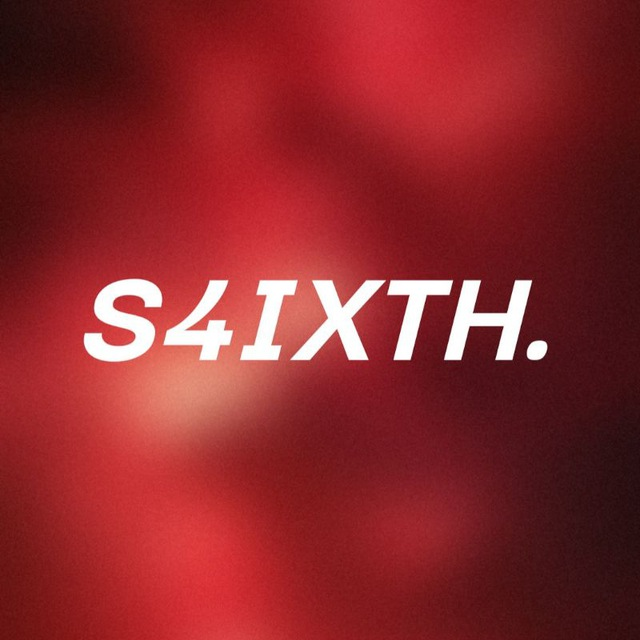

<div align="center">
  
  <h1>Sarath</h1>
  <p><strong>systems • android internals • reverse engineering</strong></p>
  <p>
    <a href="https://saisarath.com"><code>saisarath.com</code></a> •
    <a href="https://x.com/saisarathbb"><code>@saisarathbb</code></a> •
    <a href="https://telegram.me/saisarath"><code>telegram</code></a> •
    <a href="mailto:hello@saisarath.com"><code>hello@saisarath.com</code></a>
  </p>
</div>

---

### Focus

Building minimal, performance-critical tools across Android system internals, embedded hardware, and television platforms. Focused on zero-latency launcher architectures, SELinux policies, and DRM security bypasses.

---

### Featured Project

- **[firetv-clean-root](https://github.com/s-sarathb/firetv-clean-root)**  
  Native launcher replacement, bloatware disablement, and in-memory root toolkit for Amazon Fire TV (Fire OS 7). Integrates GhostLock kernel root for 0 ms Home handover, settings intent routing fixes, and complete privacy sanitization.

---

### Tech & Tooling

```
Platforms  : Android TV, Fire OS, Linux
Languages  : Java, Shell, Python, Smali
Internals  : ADB, Binder IPC, SELinux, Kernel Exploits
```

---

<p align="center">
  <sub><a href="https://saisarath.com">saisarath.com</a> • Minimal by design.</sub>
</p>
